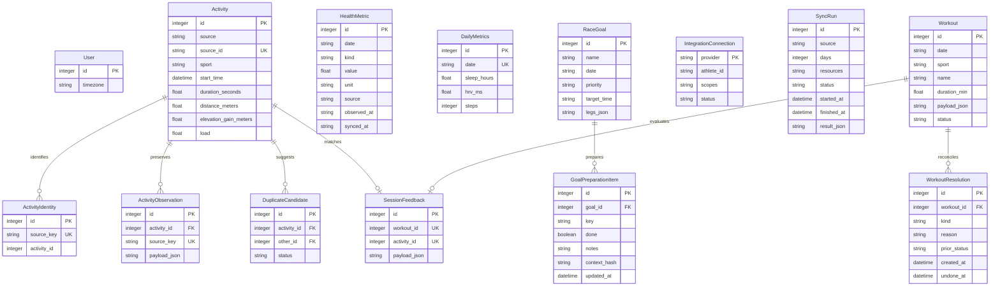

# Iron Coach — architettura e contratti

Iron Coach è un'applicazione personale locale: FastAPI, SQLAlchemy/SQLite e interfaccia HTML/CSS/JavaScript responsive. Le cinque sezioni sono Home, Salute, Attività, Coach e Obiettivi; calendario, pianificazione, feedback e import FIT restano disponibili. Non introduce registrazione, account multipli o una leaderboard.

Intervals.icu è la fonte primaria dei dati biometrici e di carico. I dati inseriti a mano rimangono conservati e costituiscono un ripiego esplicito. Il Coach usa regole verificabili e non invia dati a un modello linguistico esterno.

## Confine dell'integrazione Strava

L'integrazione Strava visualizza soltanto le attività personali autorizzate, in una sezione distinta e con cache temporanea in memoria di massimo 24 ore. Quei dati non alimentano le attività canoniche, le valutazioni del Coach, le metriche salute o l'indice gara. Riavviando il processo la cache si perde; scollegando l'account viene eliminata.

Questo è un cambiamento rispetto alla proposta iniziale di sincronizzazione unificata: le [condizioni API Strava](https://www.strava.com/legal/api_policy) verificate durante l'implementazione limitano combinazione e analisi dei dati e la durata della cache. Non si usano scraping, endpoint social non documentati o dati degli atleti seguiti.

## Struttura dei dati

Le tabelle aggiunte sono additive. Il profilo personale esistente resta il riferimento per le impostazioni dell'atleta; `iron_users` registra l'identità locale unica e il fuso orario. Non esistono chiavi `user_id` su ogni tabella perché questa versione serve un solo utente.



`RaceGoalLeg` è un oggetto validato, conservato nell'array ordinato `RaceGoal.legs_json`, anziché una tabella separata. Ogni frazione contiene `sport`, `terrain`, `distance_km`, `elevation_gain_m`, `elevation_loss_m`, `altitude_min_m`, `altitude_max_m` e `requirements`. La quota massima non può essere inferiore alla minima. La gara ammette da una a dieci frazioni.

La chiave unica di `HealthMetric` è `(date, kind, source)`; `value` può essere `null`. Le metriche previste comprendono CTL, ATL, TSB, sonno, HRV, frequenza a riposo, passi, stress, carico quotidiano manuale e Body Battery. Un dato mancante non diventa zero. Lo zero è valido per quantità che possono essere nulle, come passi e carico.

Le credenziali non sono contenute nelle tabelle o nelle risposte API. Il deposito locale usa Windows DPAPI; per Strava il rinnovo salva insieme access token, refresh token e scadenza.

### Provenienza, identità e migrazioni

- A parità di giorno e metrica un valore Intervals disponibile precede quello manuale. Un valore remoto nullo consente il ripiego manuale senza cancellarlo.
- `ActivityIdentity.source_key` identifica univocamente il fornitore e l'ID remoto. Reimportare la stessa identità aggiorna la sua osservazione senza creare una seconda attività.
- Somiglianze di sport, orario, durata e distanza creano un `DuplicateCandidate`. La fusione richiede una conferma esplicita; entrambe le osservazioni e identità vengono conservate. Due feedback già presenti impediscono la fusione con errore 409.
- Le migrazioni versionate creano un backup SQLite coerente in `data/backups` prima dell'aggiornamento. La versione 1 aggiunge i dati Iron Coach e copia le metriche manuali; la versione 2 aggiunge riconciliazioni e preparazione per obiettivo. Conservano le tabelle e i valori originali. Ripetere l'avvio a migrazione applicata non ricopia i dati e non crea un altro backup.
- `WorkoutResolution` conserva la scelta esplicita tra seduta saltata e riposo, il motivo e l'eventuale annullamento. Esiste una sola riconciliazione attiva per seduta; l'annullamento conserva lo storico.
- `GoalPreparationItem` è univoco per `(goal_id, key)`. La firma del contesto impedisce che una conferma precedente resti valida dopo una modifica alle specifiche interessate; le note rimangono disponibili.

### Cartella dati isolata

`IRON_DATA_DIR` seleziona la cartella dati prima dell'avvio del processo. Il valore predefinito è `data` nel progetto. La cartella selezionata contiene `coach.db`, `backups`, il profilo legacy `athlete_profile.json` e i file DPAPI in `.secrets`. Un percorso diverso usa quindi un database, un profilo legacy e un deposito credenziali separati, senza copiare quelli esistenti.

Esempio di avvio per una verifica locale separata:

```powershell
$env:IRON_DATA_DIR = Join-Path $PWD '.local-check-data'
$env:IRON_AUTO_SYNC = '0'
.\.venv-web\Scripts\python.exe -m uvicorn app.main:app --host 127.0.0.1 --port 8001
```

Le variabili delle credenziali, se presenti nell'ambiente, mantengono effetto anche con una cartella distinta. Per una verifica senza account non configurarle; la sincronizzazione automatica dell'esempio è disabilitata. Il profilo corrente è conservato in `athlete_settings`; il file legacy serve come riferimento iniziale quando manca quel record.

## API REST

Le date giornaliere sono `YYYY-MM-DD`; attività e settimana vengono attribuite al giorno dell'atleta nel fuso `Europe/Rome`. Le API di scrittura e collegamento devono essere invocate dal computer che ospita il backend; un `Origin` differente viene rifiutato. I segreti non sono restituiti al browser.

| Metodo e percorso | Risultato |
| --- | --- |
| `GET /dashboard/home` | Condizione, riepilogo della settimana, confronto equivalente precedente, Coach e stato fonti |
| `GET /health/metrics?from=2026-10-01&to=2026-10-17` | Serie, unità, provenienza, spiegazioni, baseline disponibili e obsolescenza |
| `GET /activities/{id}/assessment` | Punteggio eventualmente nullo, giudizio, evidenze, limiti, azioni, benefici attesi e versione regole |
| `GET /coach/overview` | Gestione del piano, evidenze, correzioni e spiegazioni delle prossime sedute |
| `GET /goals` | Obiettivi ordinati per data |
| `POST /goals` | Creazione, risposta 201 |
| `GET /goals/{id}` | Configurazione dell'obiettivo |
| `PATCH /goals/{id}` | Aggiornamento parziale; `legs` sostituisce l'intero array |
| `DELETE /goals/{id}` | Eliminazione, risposta 204 |
| `GET /goals/{id}/gap-analysis` | Copertura dei requisiti, dati mancanti e indice aggregato quando calcolabile |
| `GET /activities/duplicates/pending` | Coppie candidate, con dati sintetici delle due attività |
| `POST /activities/duplicates/{id}/merge` | Fusione esplicita delle due registrazioni |
| `POST /activities/duplicates/{id}/keep` | Conferma che le registrazioni rimangano distinte |
| `GET /sync/runs/{id}` | Stato dell'esecuzione e risultato, anche parziale |
| `PUT /planning/goal` | Collega o scollega l'obiettivo dettagliato attivo nel profilo |
| `POST /planning/workouts/{id}/preview` | Anteprima senza scritture di spostamento, riduzione o salto |
| `PATCH /planning/workouts/{id}` | Conferma della modifica con ricontrollo dei vincoli |
| `GET /progress/week?start=2026-10-12` | Programmato/eseguito, riscontri confermati, sedute da riconciliare e correzioni |
| `PUT /progress/workouts/{id}/resolution` | Dichiarazione esplicita di seduta saltata o riposo |
| `DELETE /progress/workouts/{id}/resolution` | Annulla la riconciliazione mantenendone lo storico |
| `GET /progress/recovery?days=28` | Trend personali e check-in; `days` da 7 a 90 |
| `GET /goals/{id}/preparation` | Checklist dinamica, evidenze e conferme personali per quella gara |
| `PUT /goals/{id}/preparation` | Salva spunte e note, con firma opzionale del contesto letto |
| `GET /backups/export` | Download JSON dei dati personali, privo di credenziali e stato connessioni |
| `POST /backups/preview` | Valida il JSON e produce un'anteprima senza sostituire dati |
| `POST /backups/restore` | Ripristino locale esplicito del contenuto appena verificato |

L'intervallo salute deve essere ordinato e non superare 3.650 giorni. Gli input non validi restituiscono 422, gli identificativi assenti 404 e i conflitti di stato 409. Una risposta di sincronizzazione `partial` non equivale a un successo totale.

### Revisione del profilo e bozze

`GET /planning/profile` restituisce `{profile, revision}`. `PUT /planning/profile` accetta l'header opzionale `If-Match: 3` oppure `If-Match: "3"`: il confronto e l'incremento della revisione sono atomici in SQLite, incluso il primo salvataggio con revisione zero. Se un'altra finestra ha già salvato, risponde 412 con `detail.message` e `detail.current_revision`, senza sovrascrivere il profilo. Un header malformato restituisce 422. I vecchi client senza header restano compatibili e mantengono la precedenza all'ultimo salvataggio.

Il client web invia la revisione su cui è stata aperta la bozza: un aggiornamento generale non la sostituisce mentre il modulo è modificato. In caso di conflitto conserva gli input e propone il caricamento esplicito del profilo aggiornato. I prossimi passi iniziali non interpretano un errore di caricamento come assenza di dati. Navigazione, filtri e avvisi di caricamento sono indipendenti dai messaggi di salvataggio.

### Obiettivo attivo e anteprima delle modifiche

`PUT /planning/goal` accetta `{"goal_id": 1}` oppure `{"goal_id": null}` per scollegare la gara. Supporta `If-Match` con la revisione del profilo e restituisce `{profile, revision}`. L'identificativo attivo è `profile.race_goal_id`; un obiettivo inesistente restituisce 404. Nome, data, priorità e tempo vengono applicati al profilo, mentre il generatore legge le frazioni dettagliate aggiornate.

L'obiettivo attivo orienta discipline, ripartizione del tempo e indicazioni sul terreno. Distanza e dislivello sono pesi convenzionali dichiarati in `allocation.proxy`: ripartiscono un volume già limitato dalla capacità e dalla disponibilità, senza predire tempi gara o aumentare automaticamente intensità e durate massime. Restano rispettati piscina, discipline escluse, recupero e tempo disponibile. Il terreno tecnico e la quota non generano prescrizioni automatiche di esposizione. Se la gara cambia dopo la generazione, `/planning/week` espone `needs_review`, `race_goal` e `goal_warnings`; se viene eliminata, il generatore usa il contesto generale senza applicare una vecchia data gara.

Prima di una modifica il client chiama:

```http
POST /planning/workouts/12/preview
Content-Type: application/json
```

```json
{"action":"shorten","duration_min":45,"reason":"Meno tempo disponibile"}
```

La risposta contiene `before`, `after`, `affected_workouts`, `impact` con minuti prima/dopo e disponibilità per giorno, `rationale`, `can_apply` e `preview_signature`. L'anteprima non salva sedute o revisioni. Il client conferma inviando lo stesso corpo a `PATCH /planning/workouts/12` con header `X-Plan-Preview: <preview_signature>`.

La firma lega la modifica a sedute, versione settimanale, revisione del profilo e specifiche della gara. Se il contesto cambia o i vincoli non consentono più l'intervento, la conferma restituisce 409 e richiede una nuova anteprima. Una firma malformata restituisce 422. L'header resta opzionale per i client precedenti, che ricontrollano comunque i vincoli ma non confrontano l'anteprima mostrata. Le azioni accettate sono `move`, `shorten`, `skip`; uno spostamento resta nella stessa settimana e tiene conto dei combinati. Sedute completate o pubblicate su Garmin sono protette. Nel passato è disponibile il salto esplicito, mentre spostamento e riduzione sono rifiutati. `POST /planning/undo` conserva i limiti già previsti e protegge anche le riconciliazioni attive.

### Settimana: programma, esecuzione e riconciliazione

`GET /progress/week` normalizza `start` al lunedì e restituisce `counts`, `totals`, `sessions`, `unconfirmed_past`, `sports`, `adherence`, `review` e `suggestions`. I conteggi distinguono `completed`, `modified`, `skipped`, `rest`, `unconfirmed` e `planned`.

Un'attività registrata senza abbinamento confermato entra nei volumi registrati, senza completare automaticamente una seduta. Un riscontro confermato può provenire da un'attività collegata oppure da feedback dichiarato; `evidence_source` esplicita la differenza. Le registrazioni future sono escluse dall'eseguito. `totals.recorded_minutes` e `confirmed_actual_minutes` restano distinti, così un feedback personale non raddoppia il volume registrato.

L'aderenza riguarda la durata: per un'esecuzione confermata vale `max(0, 100 − abs(minuti_eseguiti / minuti_previsti × 100 − 100))`. Una seduta dichiarata saltata contribuisce zero; riposo esplicito e sedute non confermate non producono un voto. La risposta mostra quanti riscontri entrano nel calcolo. Con dati insufficienti `adherence.percent` resta `null`; non è una valutazione del controllo dell'intensità.

Per una seduta pianificata nei giorni precedenti:

```http
PUT /progress/workouts/12/resolution
Content-Type: application/json
```

```json
{"status":"rest","reason":"Ho scelto un giorno di riposo"}
```

`status` accetta `skipped` o `rest`; il motivo deve contenere testo e non superare 1.000 caratteri. Entrambe le scelte impostano lo stato locale della seduta a `skipped`, conservando il significato distinto nell'evento `resolution.status`. Non creano feedback o valutazioni fittizi. La risposta contiene `workout_id`, `status` e `resolution`; ripetere la stessa scelta è idempotente finché non emergono nuove evidenze.

Le sedute del giorno corrente o future, completate, con feedback/valutazione o pubblicazione Garmin non risolta restituiscono 409. `DELETE` sullo stesso percorso ripristina lo stato pianificato e marca l'evento come annullato; nuove evidenze o uno stato remoto da risolvere bloccano l'annullamento. Il mancato riscontro resta una richiesta di conferma, senza essere trasformato in un allenamento sicuramente saltato.

### Trend personali di recupero

`GET /progress/recovery?days=28` restituisce `metrics`, `subjective`, `summary` e `limits`. Ogni metrica HRV, frequenza a riposo e sonno espone `source`, `baseline`, `current`, `recent_delta`, `counts`, `reference_range`, `status`, `stale`, `points` ed `explanation`.

`current` è la mediana delle ultime tre letture negli ultimi sette giorni. `baseline` richiede almeno sette letture della stessa fonte nei 28 giorni precedenti quella settimana recente. Nessuna osservazione entra in entrambi i gruppi. Il confronto usa la fonte della lettura più recente; non unisce uno storico manuale a letture Intervals. Il periodo scelto governa la vista, mentre il riferimento può usare le letture precedenti necessarie.

`status` descrive `above_baseline`, `below_baseline`, `unchanged`, `insufficient_data` oppure `stale`. Sopra/sotto il riferimento non equivale a buono/cattivo. I check-in sono dichiarazioni soggettive affiancate ai dati, senza un punteggio clinico o una confidenza inventata. Il colore confronta il valore recente con l'intervallo descrittivo personale spiegato più avanti.

### Preparazione della singola gara

`GET /goals/{id}/preparation` restituisce `goal_id`, `context_signature`, `gap_score`, `gap_status`, `items`, `summary` e `limits`. Le voci derivano dai requisiti attuali e includono capacità per disciplina, terreno/quota applicabili, tecnica, transizioni per gare multisport, attrezzatura, alimentazione, idratazione e gestione del ritmo. Non prescrivono dosi o quantità.

Ogni voce contiene `key`, `label`, `description`, `category`, `done`, `notes`, `evidence`, `verified`, `self_confirmed` e `confirmation_stale`. `verified` indica un riferimento quantitativo coperto dalle attività; `self_confirmed` resta una dichiarazione personale. Una spunta non modifica l'indice gara. Le chiavi operative sono `equipment`, `nutrition`, `hydration`, `pacing`, `bricks` quando applicabile e `leg_<indice>_<tipo>` per i requisiti della frazione e la tecnica.

```http
PUT /goals/1/preparation
Content-Type: application/json
```

```json
{
  "context_signature":"<firma ricevuta dal GET>",
  "items": {
    "equipment":{"done":true,"notes":"Materiale provato durante una seduta"}
  }
}
```

La firma reale è una stringa esadecimale di 64 caratteri. Se l'obiettivo cambia dopo l'apertura, la firma inviata non corrisponde e il salvataggio restituisce 409 senza applicare la bozza a requisiti diversi. Il campo è opzionale per compatibilità; il client web lo invia. Chiavi sconosciute o valori non validi restituiscono 422, un obiettivo assente 404. Le note ammettono 4.000 caratteri. Una modifica alle specifiche interessate invalida le precedenti conferme personali (`confirmation_stale`), conservandone le note per la revisione.

### Esportazione e ripristino dei dati personali

`GET /backups/export` scarica un JSON `format_version: 1`, con `generated_at` e `data`. Include attività, metriche, programma, revisioni, feedback, obiettivi, risoluzioni e note di preparazione. Se il profilo esiste soltanto nel file legacy, esporta il suo valore effettivo come impostazione del profilo. Esclude credenziali, stato connessioni/sincronizzazioni e registro degli invii Garmin; non contiene la cache API Strava.

Il ripristino segue questi passaggi:

1. Inviare il file a `POST /backups/preview` con `Content-Type: application/json`.
2. Leggere riepilogo per tabella, `total_records`, messaggio di sostituzione e `expires_at`.
3. Confermare con `POST /backups/restore` e corpo `{"preview_token":"<token>","confirmation":"RIPRISTINA"}`.

L'anteprima valida formato, tipi, tabelle/colonne ammesse, riferimenti, unicità e coerenza dei principali oggetti, senza modificare i dati personali. Il limite è 20 MB e 100.000 record. JSON non valido restituisce 422, contenuto di tipo diverso 415 e file oltre il limite 413. I file versione 1 precedenti possono omettere le nuove tabelle di avanzamento.

Il token dura dieci minuti, è monouso e appartiene allo stesso processo/database. È legato all'impronta dei dati correnti, incluso il contesto locale degli invii Garmin: qualsiasi modifica rilevante dopo l'anteprima richiede di ripeterla. Una sincronizzazione in corso, un token scaduto/usato o un contesto cambiato restituiscono 409. Un tentativo consuma il token anche quando non completa il ripristino.

La conferma sostituisce i dati personali in una transazione SQLite, conservando prima uno snapshot locale in `backups`. Aumenta la revisione del profilo per impedire che una vecchia bozza lo sovrascriva. Le connessioni e le credenziali del computer restano al loro posto; il registro locale degli invii Garmin viene rimosso, senza pubblicare o revocare allenamenti remoti. La risposta include `restored`, `backup_created`, `profile_revision`, `removed_remote_references` e `reload_required`: dopo il ripristino ricaricare l'app. Il ripristino è disponibile soltanto su SQLite e dal computer locale.

### Collegamenti e sincronizzazione

| Metodo e percorso | Contratto |
| --- | --- |
| `GET /integrations/intervals/status` | Configurazione, verifica, ultimo tentativo e ultimo successo |
| `POST /integrations/intervals/connect` | Corpo `{"api_key":"…","athlete_id":"0"}`; verifica prima di salvare |
| `POST /integrations/intervals/verify` | Verifica nuovamente le credenziali configurate |
| `DELETE /integrations/intervals` | Rimuove il collegamento protetto |
| `POST /sync/intervals?days=90` | Modalità attività sincrona preesistente, conservata per compatibilità |
| `POST /sync/intervals?days=90&resources=both&background=true` | Attività e wellness in background; restituisce `run_id` |
| `GET /integrations/strava/status` | `configured`, `connected`, `message`, `athlete_id`, `scopes` |
| `POST /integrations/strava/authorize` | Corpo `{}`; restituisce `authorization_url` |
| `GET /integrations/strava/callback` | Verifica `state`, completa OAuth e torna a `/app#connections` |
| `DELETE /integrations/strava` | Revoca il collegamento e svuota la cache personale |
| `POST /sync/strava?days=90` | Aggiorna la vista temporanea personale; restituisce `run_id` |
| `GET /integrations/strava/activities` | `activities`, `expires_at`, `message`; mai dati degli atleti seguiti |

La sincronizzazione usa un'esclusione per fornitore: una seconda richiesta concorrente riceve 409. Il primo import copre 90 giorni e l'utente può richiedere un intervallo storico diverso. Il processo attivo effettua l'aggiornamento automatico all'avvio e ogni 30 minuti, rileggendo gli ultimi sette giorni Intervals dopo un import completo. Strava sostituisce l'intera vista temporanea degli ultimi 90 giorni, così le rimozioni remote spariscono anche quando riguardano attività meno recenti. `IRON_AUTO_SYNC=0` disabilita questo comportamento; l'app non si aggiorna quando il backend è spento.

Configurazione Strava tramite variabili d'ambiente:

```text
STRAVA_CLIENT_ID=<client ID applicazione>
STRAVA_CLIENT_SECRET=<segreto applicazione>
STRAVA_REDIRECT_URI=http://127.0.0.1:8000/integrations/strava/callback
```

Il redirect deve corrispondere alla configurazione dell'applicazione Strava. OAuth controlla i permessi effettivamente concessi. La sincronizzazione reale richiede credenziali valide; i test automatici non verificano un collegamento reale.

### Esempio: creare un obiettivo multisport

```http
POST /goals
Content-Type: application/json
```

```json
{
  "name": "Triathlon personale",
  "date": "2027-06-01",
  "priority": "finish",
  "target_time": null,
  "legs": [
    {
      "sport": "swimming",
      "terrain": "water",
      "distance_km": 2,
      "requirements": {"weekly_hours": 2, "longest_distance_km": 2}
    },
    {
      "sport": "cycling",
      "terrain": "road",
      "distance_km": 90,
      "elevation_gain_m": 1500,
      "requirements": {"weekly_hours": 6, "longest_distance_km": 75, "longest_elevation_m": 1200}
    },
    {
      "sport": "running",
      "terrain": "trail",
      "distance_km": 21,
      "elevation_gain_m": 1000,
      "altitude_min_m": 500,
      "altitude_max_m": 2000,
      "requirements": {
        "weekly_hours": 3,
        "longest_distance_km": 18,
        "longest_elevation_m": 800,
        "terrain_confirmed": true,
        "altitude_confirmed": null
      }
    }
  ]
}
```

Le distanze e i riferimenti dell'esempio sono sintetici: non sono una prescrizione e non descrivono l'Alpsman. `priority` accetta `finish`, `improve` o `time`; `target_time` usa il formato `HH:MM:SS` con da una a tre cifre per le ore. Sport: `swimming`, `cycling`, `running`. Terreno: `road`, `trail`, `mixed`, `water`.

### Esempi di risultati parziali

Una metrica non disponibile conserva il significato di assenza:

```json
{"kind":"hrv_ms","unit":"ms","points":[],"latest":null,"baseline":null,"stale":false}
```

Un indice gara può avere singole misure disponibili senza un totale:

```json
{
  "goal_id": 1,
  "score": null,
  "status": "insufficient_data",
  "method_version": "coverage-1",
  "legs": [{
    "sport": "running",
    "terrain": "trail",
    "requirements": [
      {"kind":"longest_distance_km","reference":18,"observed":15,"score":83.3,"gap":3},
      {"kind":"altitude_confirmed","reference":true,"observed":null,"score":null,"gap":null}
    ]
  }]
}
```

Questi esempi sono estratti delle risposte: l'API aggiunge spiegazioni, limiti e gli altri campi del relativo contratto.

## Regole verificabili

### Salute e Home

Il sonno Intervals in secondi viene convertito in ore; TSB viene derivato da `CTL − ATL` dello stesso giorno e della stessa fonte. Non si inferisce HRV, sonno o frequenza a riposo da attività sportive. Le spiegazioni descrivono il significato e i limiti della metrica senza attribuire una causa clinica al singolo valore.

Le baseline HRV e frequenza a riposo sono la mediana di almeno sette osservazioni precedenti della stessa fonte negli ultimi 28 giorni. Un dato più vecchio del giorno precedente alla fine dell'intervallo è contrassegnato come obsoleto. La baseline non combina misurazioni manuali e remote. Lo stress Intervals mantiene il valore e la scala nativi (`stress_level`), distinti dallo stress percepito manuale 0–100; non viene convertito arbitrariamente.

La Home confronta la settimana da lunedì a oggi con gli stessi giorni della settimana precedente. Il trend di carico è `(carico_corrente / carico_precedente − 1) × 100`; se il denominatore è zero o manca un carico necessario non è calcolato. Per le attività fuse il carico Intervals precede il valore locale. Le stime locali di CTL/ATL/TSB sono etichettate `local_estimate`, con spiegazione dei parametri, senza presentarle come dati importati.

### Colori delle metriche e significato

`web/metric-status.js` applica lo stesso linguaggio a Home, Salute, recupero, valutazioni e copertura gara. Il colore accompagna sempre icona, etichetta e spiegazione; non è l'unico modo per distinguere gli stati.

| Colore | Stato interno | Significato |
| --- | --- | --- |
| Rosso | `critical` | Punteggio della scala a cinque livelli sotto 35, oppure regola critica specifica del carico |
| Arancio | `caution` | Punteggio da 35 a meno di 50; anche controlli qualitativi o copertura gara parziale possono usare questo stato |
| Giallo | `watch` | Punteggio da 50 a meno di 65: scostamento o progressione da seguire |
| Verde chiaro | `positive` | Punteggio da 65 a meno di 80: indicatore discreto, con margine da consolidare |
| Verde | `good` | Punteggio almeno 80; nella copertura gara, riferimento quantitativo coperto al 100% |
| Grigio | `detraining` | CTL ridotto di oltre il 10% rispetto a una lettura di almeno due settimane prima, con almeno sette osservazioni precedenti comparabili; può riflettere uno scarico programmato |
| Blu | `neutral` | Dato senza graduazione di prestazione, come peso registrato, stima locale o conferma personale della checklist |
| Bianco | `unknown` | Dati mancanti, obsoleti o insufficienti; stima di recupero con copertura dei segnali inferiore al 50% |

Le soglie 35/50/65/80 sono quelle di `five`, usata per il voto della seduta, il recupero e gli indicatori personali che dispongono di un confronto. Non cambiano il significato fisiologico dei numeri né rendono il peso un punteggio: ciascuna metrica mantiene le proprie regole. Il grigio descrive una riduzione osservata del carico cronico, senza certificare una perdita di prestazione. Le card di solo contesto non sono mostrate nella griglia Salute; il peso rimane visibile e apre il suo andamento.

Per HRV, frequenza a riposo e sonno l'intervallo è descrittivo: almeno sette osservazioni comparabili della stessa fonte, `Q1 − 1,5 × IQR` fino a `Q3 + 1,5 × IQR`, con il limite inferiore troncato a zero. In Salute si usano i 28 giorni precedenti l'ultima lettura; nel recupero i 28 giorni precedenti la settimana recente, confrontati con la mediana delle tre letture recenti. `reference_range` è `null` quando manca uno storico sufficiente; quando disponibile espone `lower`, `upper`, `count` e `method: descriptive_iqr`.

HRV, frequenza a riposo e sonno usano il rapporto con il proprio riferimento e l'intervallo descrittivo: la gravità dello scostamento determina il livello. Un HRV insolitamente alto non viene considerato automaticamente migliore; quando la lettura è fuori dall'intervallo, il punteggio del singolo indicatore non supera 55. Un sonno nella durata abituale non certifica qualità o recupero. Le stime locali rimangono blu. ATL considera il rapporto con il CTL della stessa fonte e data; TSB ≤ −30 è rosso e da −30 escluso a −25 incluso è arancio. Il recupero usa le cinque fasce della tabella; una copertura dei segnali inferiore al 50% mantiene lo stato bianco `unknown`. Queste sono regole dichiarate dell'app, non soglie mediche o garanzie di sicurezza.

### Coach `rules-1`

Una seduta richiede un abbinamento confermato al programma e almeno un dato valutabile di intensità o RPE. La sola durata produce `score: null` e “Non valutabile”. Non si assegna un voto in base alla lunghezza dell'attività.

Il punteggio usa la media di aderenza alla durata e componenti disponibili di controllo dell'intensità/RPE. L'aderenza penalizza sia il difetto sia l'eccesso rispetto alla durata prevista. Il controllo dell'intensità richiede dati confrontabili per fase; la sola potenza media non dimostra esecuzione corretta degli intervalli. L'RPE è confrontato con quello atteso dal programma.

| Punteggio | Giudizio |
| --- | --- |
| Mancante | Non valutabile |
| Inferiore a 40 | Scarso |
| Da 40 a meno di 60 | Insufficiente |
| Da 60 a meno di 75 | Adeguato |
| Da 75 a meno di 90 | Buono |
| Da 90 | Eccellente |

Il riepilogo Coach usa almeno tre sedute valutabili negli ultimi 28 giorni: da 75 “Corretta”, da 60 “Mediamente Corretta”, sotto 60 “Scorretta”. Se restano sedute programmate nei giorni passati senza conferma, il giudizio globale resta “Non valutabile”: l'assenza di registrazione non dimostra mancato svolgimento. Il punteggio di sola esecuzione rimane separato in `execution_score`. Espone quante attività sono valutabili e chiarisce che questo giudizio riguarda l'esecuzione del piano. Non certifica la validità fisiologica del programma. Le prossime sedute mostrano motivo e stimolo atteso per disciplina, senza dichiarare adattamenti già misurati.

### Copertura gara `coverage-1`

Si usano le attività canoniche degli ultimi 90 giorni, separate per disciplina. I riferimenti sono configurati esplicitamente dall'utente e non vengono ricavati automaticamente dalla distanza di gara.

- `weekly_hours`: media sulle ultime quattro settimane complete, includendo le settimane senza registrazioni.
- `longest_distance_km`: massima distanza osservata nella disciplina nella finestra di 90 giorni.
- `longest_elevation_m`: massimo dislivello di una singola attività nella stessa finestra; non è richiesto per una frazione pianeggiante se non è configurato un riferimento.
- Ogni requisito quantitativo disponibile vale `min(osservato / riferimento, 1) × 100`.
- Terreno trail/misto e quota richiedono conferme esplicite distinte: `true` vale 100, `false` vale 0 e `null` significa dato insufficiente. Il dislivello non conferma preparazione all'altitudine.
- Il totale è la media di tutti i requisiti applicabili, soltanto se ciascuno ha un punteggio. Altrimenti `score` resta nullo e l'API espone le misure parziali.

È un indice euristico di copertura dei riferimenti: non esprime probabilità di completamento, sicurezza in quota o recupero giornaliero. La mancanza di attività registrate limita il risultato; non prova assenza di allenamento. Nessuna gara commerciale viene precompilata senza dati verificati.

## Verifica e limiti operativi

I test backend usano SQLite isolato e dati sintetici. Coprono provenienza e zero/null, wellness parziale, baseline, obiettivi, indice completo/parziale, soglie Coach, abbinamenti, deduplicazione, carico nella Home, protezioni locali e migrazioni. Le suite 1.3 verificano anche obiettivo attivo, anteprima senza scritture e firme obsolete, riepiloghi con evidenze mancanti o future, riconciliazione/annullamento, trend della stessa fonte, checklist e contesto modificato, backup validi/non validi, ripristino atomico e conflitti dopo l'anteprima. I test DOM verificano flussi, bozze, messaggi e stati della presentazione.

```powershell
.\.venv-web\Scripts\python.exe -m pytest tests -q -p no:cacheprovider
```

I test delle integrazioni simulano API, errori e credenziali. Un risultato automatico positivo non dimostra che l'account reale sia collegato o che tutti i campi siano disponibili dal fornitore. Il backend deve restare attivo per sincronizzare; una distribuzione pubblica o multiutente richiede un'architettura distinta di autenticazione, custodia dei segreti e isolamento dei dati.

Verifica storica 1.2: 232 test backend e 40 test DOM superati; sintassi JavaScript valida. Nella verifica 1.1 le nuove route e lo schema OpenAPI rispondevano nell'app completa e il frontend è stato caricato in JSDOM con API locali reali, senza inviare moduli o modificare dati utente.

Verifica 1.3 del 18 ottobre 2026: 490 test backend e 116 test frontend superati. La prova integrata in JSDOM con server locale e dati sintetici isolati ha completato sei flussi con 124 richieste, zero errori HTTP e zero errori JavaScript. Dettagli in `docs/VERIFICA_1_3.md`. Il controllo statico delle coppie di colore selezionate ha rilevato un contrasto minimo di 5,30:1; non equivale a una verifica completa di accessibilità o di layout. La verifica visiva a 360/768/1440 pixel resta incompleta: nessun browser disponibile tramite CUA e avvio Firefox rifiutato dall'approvazione automatica. Nella successiva revisione sono stati letti attività e wellness Intervals dell’account configurato ed è stata completata una sincronizzazione personale. Account Strava e trasferimenti fisici di allenamenti sui dispositivi restano non verificati. I file FIT bici/corsa richiedono ancora collaudo su Forerunner 955 ed Edge 530; il connettore Garmin cloud resta bloccato in attesa dell'accesso ufficiale.


## Revisione attività, peso e schede manuali

| Endpoint | Contratto |
|---|---|
| GET /activities/{id}/detail | Summary, streams osservati, GPS, disponibilità provider e voto coerente con lo snapshot remoto letto; nessuna mutazione delle attività |
| GET /health/metrics | Aggiunge weight_kg da wellness.weight; esclude tempWeight e zero, nessun peso predefinito promosso a misura |
| GET /athlete/derived-profile | Totali e record per attività intera, tutto lo storico/90 giorni, salute osservata e soglie documentate |
| POST /training/manual | Seduta utente nel calendario; fasi o esercizi palestra validati, controlli disponibilità e avvisi, nessuna attività registrata |
| GET /training/gym/{id}/progress | Scheda e progresso persistente, timer scaduto ricalcolato correttamente |
| PUT /training/gym/{id}/progress | expected_revision, serie completate, esercizio attivo, timer e note; conflitti respinti |

La generazione automatica conserva le sedute manuali. Spostare una scheda mantiene gli esercizi. Accorciare una seduta aerobica manuale riduce le sue fasi originali; il generico accorciamento di una scheda palestra viene respinto per evitare di cambiare durata lasciando serie incoerenti. Il nuovo gym_progress è una tabella additiva e opzionale nei backup precedenti.

Verifica finale di questa revisione: 490 test backend e 116 test frontend; prova integrata palestra/pianificazione con 66 richieste HTTP, zero errori e nessuna attività creata. Grafici SVG renderizzati e ispezionati come artefatti; il layout completo nel browser rimane non verificato.

## Grafici e disponibilità temporanee

La revisione successiva introduce `web/charts.js`: statistiche dei campioni, esplorazione, zoom e fasce personali. Le fasce HRV/sonno/FC a riposo restano descrittive; il riferimento Z2 bici richiede la FTP del profilo. Nessuna zona cardiaca ottimale è dedotta dal massimo registrato.

`PlanningProfile.time_constraints` conserva periodi, giorni e fasce bloccate. Le route `/planning/coach/preview` e `/planning/coach/apply` interpretano disponibilità e pause, mostrano l’impatto e proteggono l’applicazione con firma dello stato e revisione del profilo. Il calendario espone le fasce ammesse; la generazione riduce la capienza e non aggiunge sedute nei giorni bloccati. Le sedute già presenti in conflitto restano visibili per una decisione esplicita. Il backup del profilo include le regole senza una nuova tabella.

La palestra aggiunge basi e catalogo, riordino e riutilizzo con nuovo progresso indipendente. Verifica: 511 test backend, 130 frontend, 131 richieste integrate isolate senza errori. Dettagli, fonti e limiti in `docs/GRAFICI_E_DISPONIBILITA_2026_10_18.md`.
